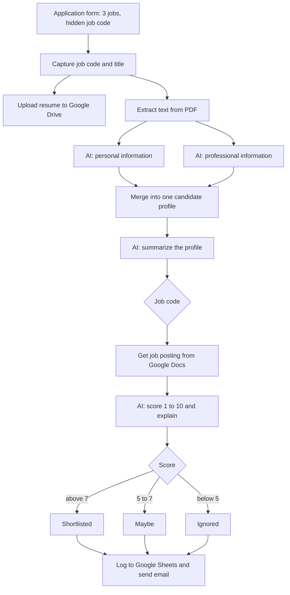
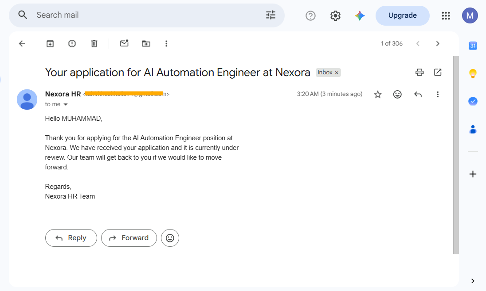
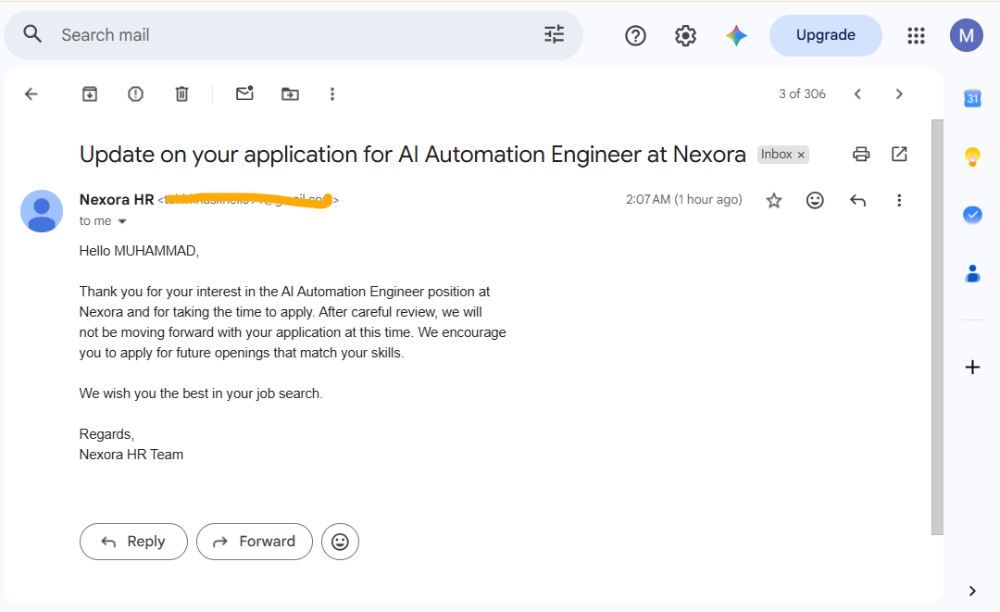
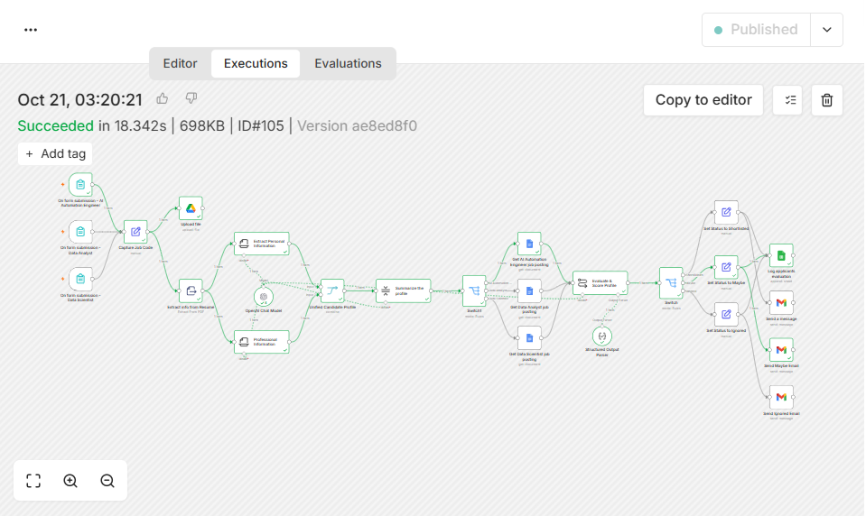

# AI HR Recruitment Assistant (n8n)

An n8n workflow that screens job applications end to end. A candidate applies through a form, the workflow reads the resume PDF, extracts the candidate's details with AI, scores them from 1 to 10 against the matching job posting, logs everything in Google Sheets, and emails the candidate a status-specific reply.


<!-- DEMO VIDEO: when the Loom is recorded, add this line here:
🎥 **Video walkthrough:** [Watch the demo on Loom](YOUR_LOOM_LINK)
-->

**Quick facts**

| | |
|---|---|
| **Input** | n8n application form (first name, last name, email, resume PDF) with a hidden job code |
| **Output** | Applicant row in Google Sheets (score, status, written assessment, extracted profile) and an email to the candidate |
| **Roles** | AI Automation Engineer, Data Analyst, Data Scientist (one form and one job posting each) |
| **AI** | GPT-4o-mini through n8n LangChain nodes with structured output |
| **Routing** | Score above 7 is Shortlisted, 5 to 7 is Maybe, below 5 is Ignored |
| **Stack** | n8n, OpenAI, Google Drive, Google Docs, Google Sheets, Gmail |

## Who this is for

- **Small companies and startups** that get many applications and have no applicant tracking system.
- **Recruiters and HR teams** who want a first-pass ranking and a tracker without copying data by hand.
- **Automation freelancers** looking for a reference build for document parsing, AI scoring and routing in n8n.

## What problem it solves

Reading every resume, copying the details into a spreadsheet and replying to each candidate takes hours and is inconsistent. This workflow does the repetitive part: it parses the resume, scores it against the actual job posting with the same instructions every time, writes a reasoned assessment to the tracker, and makes sure every applicant gets a reply.

It is a screening aid. A person should still make the hiring decision (see [Privacy and fairness](#privacy-and-fairness)).

## How it works



1. **Three application forms** (AI Automation Engineer, Data Analyst, Data Scientist) collect first name, last name, email and a PDF resume. Each form has a hidden `hdn-job-code` field (`job-code-001`, `-002`, `-003`).
2. **Resume handling.** The PDF is saved to Google Drive as `<job-code>-<First>-<Last>`, and its text is extracted.
3. **Two AI extractions** run in parallel with n8n's Information Extractor and a JSON schema:
   - personal: full name, email, phone, city, LinkedIn
   - professional: education, job history, skills, years of experience, latest title and employer
4. **One candidate profile.** The two results are merged and summarized into a short profile.
5. **Job matching.** The job code selects the right job posting from Google Docs.
6. **AI scoring.** The model compares the profile with the posting and returns `ai_resume_score` (1 to 10) and `ai_evaluation` (its reasoning) through a structured output parser.
7. **Routing and reply.** A Switch sets the status, the applicant is appended to the Google Sheets tracker, and Gmail sends the shortlisted, under-review or not-selected email.

## Demo

The screenshots show test applications submitted by the author with their own resumes, so the personal details in them are the author's.

### 1. Application form
Candidates apply with their name, email and resume (PDF). Each job has its own form with a hidden job code.


### 2. Resumes stored in Google Drive
Resumes are saved automatically and named by job code and candidate name.


### 3. Applicant tracker in Google Sheets
Every applicant is logged with an AI score from 1 to 10, a status, a written assessment and the extracted profile.


### 4. Automated emails
Candidates receive a status-specific email: shortlisted, under review, or not selected.

**Shortlisted**


**Under review**



**Not selected**



### 5. Successful execution



## Design decisions

- **Structured outputs, not parsing code.** Both extraction steps and the scoring step return typed JSON, so no regex or string parsing is needed on AI output.
- **Same job posting, same instructions.** The score is based on the real posting text from Google Docs, not on the model's idea of the role, and every candidate is scored with one fixed prompt.
- **The reasoning is stored with the score.** The tracker keeps the written assessment next to the number, so a reviewer can see why a candidate got a 3 or an 8.
- **Job codes drive everything.** One hidden field selects the job title, the posting document and the Drive file name, so a new role is a copy of an existing branch.
- **Parallel extraction.** Personal and professional details are extracted at the same time and merged.
- **Placeholders instead of secrets.** Credentials, folder, sheet and document ids are removed from the exported JSON (see [Setup](#setup)).

## Customizing it

| Change | Where |
|---|---|
| Score thresholds | `Switch` node (currently above 7 is Shortlisted, 5 or more is Maybe) |
| Scoring criteria | System message of the `Evaluate & Score Profile` node |
| What gets extracted | Schema and attributes of the two Information Extractor nodes |
| Email wording and company name | The three Gmail nodes (`Send a message`, `Send Maybe Email`, `Send Ignored Email`) |
| A new role | Copy a form trigger, add a job posting Google Doc and a new output on `Switch1`, and add the job code and title to `Capture Job Code` |
| AI model | The `OpenAI Chat Model` node |

## Tech stack

| Area | Tools |
|---|---|
| Automation | n8n |
| AI | OpenAI GPT-4o-mini, LangChain nodes (Information Extractor, Summarization Chain, Basic LLM Chain, Structured Output Parser) |
| Storage and data | Google Drive, Google Docs, Google Sheets |
| Communication | Gmail |
| Input | n8n Form Trigger |

## Setup

1. Import `workflow/ai-hr-recruitment-assistant.json` into n8n (**Workflows → Import from file**).
2. Create credentials for OpenAI, Google Drive, Google Docs, Google Sheets and Gmail, then reconnect them on each node (the export contains `REPLACE_CREDENTIAL_ID` placeholders).
3. Replace the placeholders in the workflow:

   | Placeholder | What to use |
   |---|---|
   | `YOUR_DRIVE_FOLDER_ID` | Drive folder where resumes are stored |
   | `YOUR_GOOGLE_SHEET_ID` | Applicant tracker spreadsheet |
   | `YOUR_AI_ENGINEER_JOB_DOC_ID` | Google Doc with the AI Automation Engineer posting |
   | `YOUR_DATA_ANALYST_JOB_DOC_ID` | Google Doc with the Data Analyst posting |
   | `YOUR_DATA_SCIENTIST_JOB_DOC_ID` | Google Doc with the Data Scientist posting |

4. Create the tracker sheet with these columns:
   `Job Code`, `Applicant Name`, `Applicant Email`, `Application Date`, `Final Score`, `AI Status`, `AI Assessment`, `Total Experience`, `Experience Summary`, `Job History`, `Skills`, `Applicant Location`, `Applicant Phone`, `Applicant Education`
5. Write each job posting in its Google Doc. The scoring is only as good as the posting text.
6. Activate the workflow and share the three form URLs.
7. Test with a sample resume before sharing the forms.

## Repository structure

```
workflow/ai-hr-recruitment-assistant.json   the n8n workflow (credentials removed)
docs/screenshots/                           canvas, forms, tracker, emails, execution
README.md
LICENSE
```

## Privacy and fairness

- Resume text is sent to OpenAI for extraction and scoring, and resumes are stored in Google Drive. Tell applicants this, and follow your local data-protection and hiring laws.
- An AI score is a screening aid, not a hiring decision. Models can be biased by how a resume is written, and the workflow does not currently test for that.
- The "not selected" email is sent automatically. For real use, add a human review step before rejections (see the roadmap).
- Never commit real candidate data. The `.gitignore` excludes `resumes/`, CSV and Excel files.

## Known limitations

- **PDF only, text only.** Scanned or image-only PDFs have no extractable text, so extraction and scoring will be poor or fail. There is no OCR step.
- **The reply goes to the email found in the resume.** The form's email field is not used for the reply. If the resume has no email or a different one, the message goes to that address.
- **Fixed role list.** Adding a role needs workflow edits (see Customizing it).
- **The score is not calibrated.** The same resume can get slightly different scores on different runs, and the 5 and 7 thresholds are a starting point.
- **One resume per run.** There is no deduplication, so a candidate who applies twice is logged twice.
- Free or low-tier OpenAI and Google quotas can rate-limit a burst of applications.

## Roadmap

- [ ] Human review before rejection emails are sent
- [ ] Bias and fairness checks in the scoring prompt
- [ ] Slack or Telegram alert for shortlisted candidates
- [ ] Support DOCX resumes and OCR for scanned PDFs
- [ ] Deduplicate repeat applicants
- [ ] Move the placeholders to n8n variables so no JSON editing is needed before import

## Disclaimer

This is a portfolio project. AI-generated scores are a screening aid, not a hiring decision, and any real use needs human review and compliance with local hiring and data-protection laws.

## Author

**Muhammad Tahir** · AI automation and data science
[LinkedIn](https://linkedin.com/in/muhammad-tahir-data) · [GitHub](https://github.com/mtahir-ds)

## Need something similar?

I build n8n automations for businesses, from recruitment and content pipelines to WhatsApp assistants and lead workflows.

- 📧 mtahir.data@gmail.com
- 💼 [LinkedIn](https://linkedin.com/in/muhammad-tahir-data)
- 🐙 [GitHub](https://github.com/mtahir-ds)

If this repo helped you, a ⭐ is appreciated.
