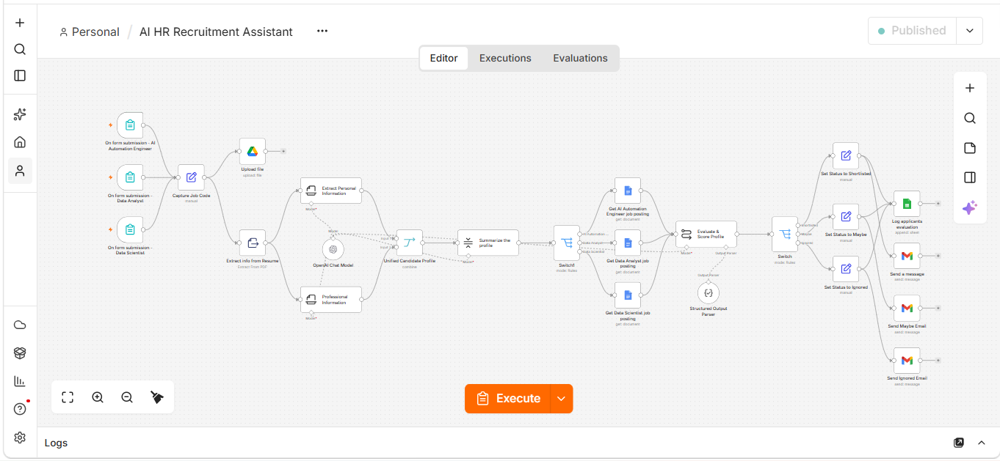
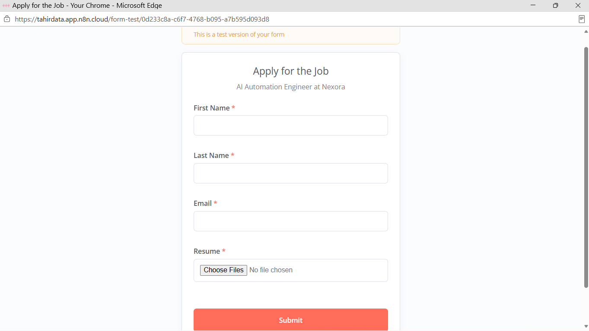
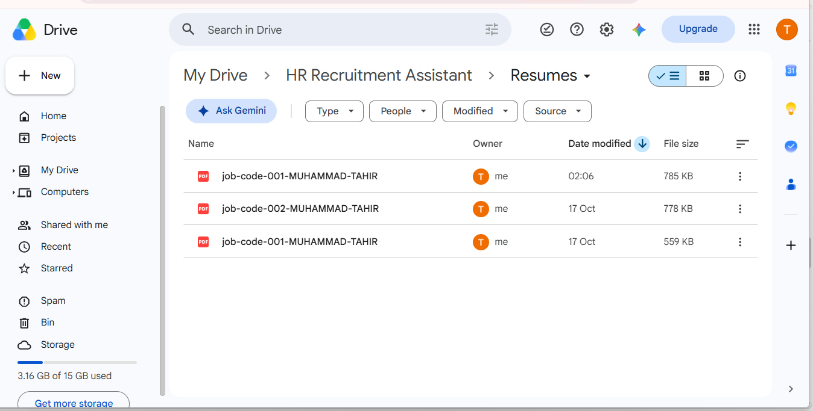
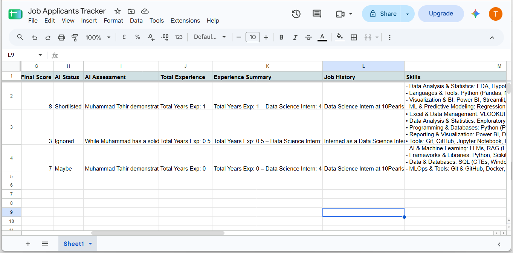
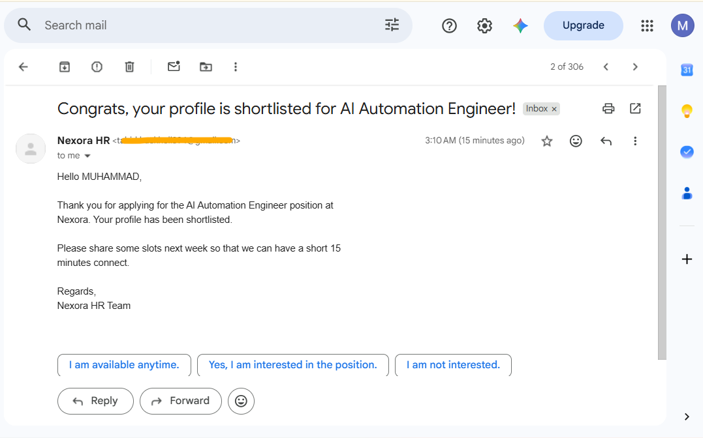

# AI HR Recruitment Assistant (n8n)

An end-to-end recruitment automation built in n8n. Candidates apply through a form, and the workflow parses their resume, scores them against the job posting with AI, logs the result, and emails the candidate automatically.




## What It Does

1. **Application forms**: three forms (AI Automation Engineer, Data Analyst, Data Scientist), each with a hidden job code.
2. **Resume handling**: the PDF is uploaded to Google Drive and its text is extracted.
3. **AI extraction**: GPT-4o-mini pulls out contact details, education, work history, skills and years of experience as structured data.
4. **Profile summary**: the extracted data is merged and summarized into a short candidate profile.
5. **Job matching**: the matching job posting is pulled from Google Docs based on the job code.
6. **AI scoring**: the model scores the candidate from 1 to 10 and explains its reasoning (structured output parser).
7. **Routing**:
   - Score above 7: **Shortlisted**
   - Score 5 to 7: **Maybe**
   - Score below 5: **Ignored**
8. **Logging and email**: every applicant is appended to a Google Sheets tracker, and a status-specific email is sent through Gmail.

## Workflow Overview

```
Application Form (x3 jobs)
        │
        ▼
 Capture Job Code
        │
        ├──► Upload resume to Google Drive
        │
        ▼
 Extract text from PDF
        │
        ├──► Extract personal info (AI)
        └──► Extract professional info (AI)
                    │
                    ▼
        Unified Candidate Profile
                    │
                    ▼
          Summarize profile (AI)
                    │
                    ▼
     Fetch job posting (Google Docs)
                    │
                    ▼
      Evaluate & score profile (AI)
                    │
                    ▼
        Route by score (Switch)
        ┌───────────┼───────────┐
   Shortlisted     Maybe      Ignored
        └───────────┼───────────┘
                    ▼
     Log to Google Sheets + Send Gmail
```

## Demo

All data shown below is fictional test data.

### 1. Application Form
Candidates apply with their name, email and resume (PDF). Each job has its own form with a hidden job code.



### 2. Resumes Stored in Google Drive
Resumes are saved automatically and named by job code and candidate name.



### 3. Applicant Tracker in Google Sheets
Every applicant is logged with an AI score from 1 to 10, a status and a written assessment.



### 4. Automated Emails
Candidates receive a status-specific email: shortlisted, under review, or not selected.

**Shortlisted**



**Under review and not selected**


### 5. Successful Execution


## Tech Stack

| Area | Tools |
|---|---|
| Automation | n8n |
| AI | OpenAI GPT-4o-mini, LangChain nodes (Information Extractor, Summarization Chain, Structured Output Parser) |
| Storage and data | Google Drive, Google Docs, Google Sheets |
| Communication | Gmail |
| Input | n8n Form Trigger |

## Setup

1. Import `workflow/ai-hr-recruitment-assistant.json` into n8n (**Workflows → Import from file**).
2. Create credentials for OpenAI, Google Drive, Google Docs, Google Sheets and Gmail, then reconnect them on each node.
3. Replace the placeholders in the workflow:

   | Placeholder | What to use |
   |---|---|
   | `YOUR_DRIVE_FOLDER_ID` | Drive folder where resumes are stored |
   | `YOUR_GOOGLE_SHEET_ID` | Applicant tracker spreadsheet |
   | `YOUR_AI_ENGINEER_JOB_DOC_ID` | Google Doc with the AI Automation Engineer posting |
   | `YOUR_DATA_ANALYST_JOB_DOC_ID` | Google Doc with the Data Analyst posting |
   | `YOUR_DATA_SCIENTIST_JOB_DOC_ID` | Google Doc with the Data Scientist posting |

4. Create the tracker sheet with these columns:
   `Job Code`, `Applicant Name`, `Applicant Email`, `Application Date`, `Final Score`, `AI Status`, `AI Assessment`, `Total Experience`, `Experience Summary`, `Job History`, `Skills`, `Applicant Location`, `Applicant Phone`, `Applicant Education`
5. Activate the workflow and share the three form URLs.

## Customization

- **Score thresholds**: edit the `Switch` node (currently above 7 is Shortlisted, 5 or more is Maybe).
- **Scoring criteria**: edit the system message in the `Evaluate & Score Profile` node.
- **New roles**: add a form trigger, a job posting doc, and a new branch in `Switch1`.
- **Email wording**: edit the three Gmail nodes.

## Possible Improvements

- Add a human-review step before rejection emails are sent
- Add bias and fairness checks to the scoring prompt
- Send a Slack or Telegram alert for shortlisted candidates
- Support DOCX resumes in addition to PDF

## Disclaimer

This is a portfolio project. AI-generated scores are a screening aid, not a hiring decision, and any real use needs human review and compliance with local hiring and data-protection laws.

## Author

**Muhammad Tahir**
[LinkedIn](https://linkedin.com/in/muhammad-tahir-data) · [GitHub](https://github.com/mtahir-ds)